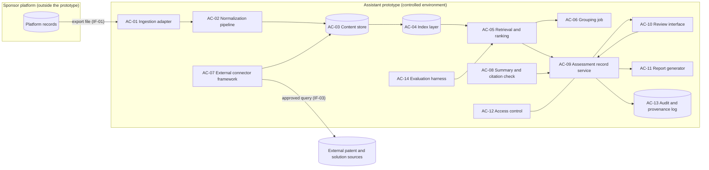

# S04_ARCHITECTURE

| Field | Value |
|---|---|
| Document ID | S04_ARCHITECTURE |
| Version | 1.0 |
| Status | SUBMITTED FOR GATE |
| Stage | S04 |
| Date | 2026-11-20 |
| Depends on | S01_REQUIREMENTS_REGISTER; S02_RESEARCH_SYNTHESIS §3–§4; S03_COMPARABLE_SYSTEMS_MATRIX §5; CLM-011; CLM-012; CLM-021; CLM-026; CLM-028; CLM-035; CLM-036; CLM-040; S04_SCOPE_OPTIONS |

- **Status of content:** everything in this file is PROPOSED design unless a row cites a source. No component exists. Tool and model names are deliberately absent: versions, licences and resource needs are verified in S05 and S07 (QA-010).
- **Scope basis:** written for the recommended Option B (`S04_SCOPE_OPTIONS` §4). The functional decomposition also serves Options A and C; §7 states what changes.
- **IDs defined here:** FN (function), AC (architecture component), CP (R3 checkpoint), AD (architecture design choice). Interfaces (IF) and data flows (DF) are in `S04_DATA_FLOWS_AND_INTERFACES`; assumptions (AS) in `S04_ASSUMPTIONS_AND_STANDARDS`.

## 1. Product boundary

The assistant sits beside the sponsor's submission platform. It reads submissions, retrieves related material from three corpora, and prepares an assessment record that an assessor completes and approves. It does not assess submissions, does not change platform records and does not finalize any outcome (R3).

The three corpora are kept apart because their owners, access rules and update cycles differ:

| Corpus | Content | Serves | Availability |
|---|---|---|---|
| Submission corpus | Stored platform submissions, imported from an export | R1 | OPEN (ISS-002, ISS-008); proxy if unavailable (AS-01) |
| Internal collection | The "approved internal collection" of solutions or precedents | R2 | Not established (ISS-003, CLM-012); proxy if unavailable (AS-02) |
| External evidence cache | Patent records and solution examples returned by external sources, stored with provenance | R4 | Depends on source terms (ISS-006, RQ-14) |

## 2. Functional scope

"Current" means built and tested in the funded project under Option B. "Future" items are Section 11 material only (FX-06).

| ID | Function | Requirement | Current project | Future |
|---|---|---|---|---|
| FN-01 | Submission ingestion: import exported submissions and internal-collection items from files; validate fields; keep source identifiers and import version | R1, R2 | File import (AD-03) | Platform adapter through IF-07 |
| FN-02 | Text normalization and enrichment: field mapping, cleaning, exact-copy hashing, near-duplicate fingerprints, language tag, passage segmentation for long texts | R1, R2, R4 | Yes | Additional languages if ISS-007 requires |
| FN-03 | Similar-submission search: for a new submission, rank stored submissions and show the matched passages or fields behind each candidate | R1 (reading a, ISS-004) | Yes | — |
| FN-04 | Stored-collection grouping: propose groups of likely duplicate or overlapping stored submissions for assessor confirmation | R1 (reading b, ISS-004) | Yes, batch job; groups are proposals until CP-4 | Scheduled re-grouping on platform data |
| FN-05 | Internal precedent retrieval: rank internal-collection items that may address the submission, with evidence passages | R2 | Yes on the sponsor's collection if ISS-003 allows; otherwise on a proxy collection (`S04_SCOPE_OPTIONS` §4, condition 2) | — |
| FN-06 | External prior-art retrieval: build a query from the submission, let the assessor edit and approve it (CP-1), search external sources, store results with provenance | R4 | Patent source first (AD-04); solution-example sources only if ISS-006 identifies one | Further connectors |
| FN-07 | Evidence-grounded summaries: optional generated summary of retrieved items in which every sentence cites a retrieved item and passes an automatic support check | R2, R4 (assessor support) | Optional, off by default (AD-08) | Enabled if ISS-009 and evaluation results allow |
| FN-08 | Assessment record and report: one record per submission linking R1, R2 and R4 candidates, evidence, assessor decisions, outcome, approver and component versions; exportable report | R1–R4, R3 | Yes | Write-back of approved outcomes to the platform |
| FN-09 | Review and approval workflow enforcing CP-1 to CP-6 | R3 | Yes | Sponsor-specific approval chains |
| FN-10 | Decision logging: store assessor decisions on candidates as labelled examples for later analysis | C3 | Logging and export only (AD-10) | Learning-to-rank or active learning from logged decisions (CLM-011) |
| FN-11 | Administration and access control: roles, accounts, thresholds, connector settings | R3, C2 | Project-managed accounts (AS-05) | Sponsor identity provider |
| FN-12 | Offline evaluation harness: time-ordered splits, judged test sets, metric scripts, overreliance checks | QA-002, QA-004 | Yes (project tooling, not a product feature) | Re-used for monitoring in a pilot |

Not in any phase: autonomous approval or rejection of submissions; automatic merging or deletion of platform records; self-training without assessor review (C3; REF-01 §17).

## 3. Components

| ID | Component | Responsibility | Functions | Key dependency or open point |
|---|---|---|---|---|
| AC-01 | Ingestion adapter | Parse export files (IF-01), validate against the field map, reject malformed rows with a report, assign internal IDs, keep platform IDs | FN-01 | Export format OPEN (ISS-008) |
| AC-02 | Normalization pipeline | Field mapping, cleaning, hashing, near-duplicate fingerprints (S02 M-2.5), language tag, passage segmentation | FN-02 | Field list OPEN (ISS-005, ISS-008) |
| AC-03 | Content store | Versioned storage of submissions, collection items, external results, records; persistence and access control for the index layer, which a vector library alone does not provide (S02 §4, I.2) | FN-01, FN-06, FN-08 | Retention rules OPEN (ISS-036) |
| AC-04 | Index layer | One lexical index and one vector index per corpus; rebuilt or updated on import; index version stored | FN-03 to FN-05 | Model choice S05 (RQ-15) |
| AC-05 | Retrieval and ranking service | Candidate generation (lexical and dense), fusion, optional re-ranking, evidence-span extraction; corpus-agnostic | FN-03, FN-05 | Method comparison in S05 (CLM-026) |
| AC-06 | Grouping job | Runs AC-05 over the stored corpus, links candidate pairs above a threshold, forms groups, queues them for CP-4 | FN-04 | Threshold set from S05 evaluation |
| AC-07 | External connector framework | Connector plug-ins behind IF-03; query construction, rate limits, caching, licence note per result | FN-06 | Sources and terms (ISS-006, RQ-14); disclosure (ISS-033) |
| AC-08 | Summary and citation check | Generates optional summaries from retrieved passages; checks each sentence against its cited passage; drops or flags unsupported sentences | FN-07 | Hosting decision (ISS-009) |
| AC-09 | Assessment record service | Record schema, state machine, approval enforcement, versioning; the only component allowed to change record state | FN-08, FN-09, FN-10 | Template content (ISS-005) |
| AC-10 | Review interface | Web screens for assessors: evidence-first candidate lists, per-candidate decisions, query approval, summary acceptance, approval | FN-09 | Usability check in S05 design |
| AC-11 | Report generator | Human-readable and machine-readable export of approved records (IF-05) | FN-08 | Report format to be agreed with owner |
| AC-12 | Access control | Authentication, roles (assessor, administrator, evaluator), permission checks on every IF-04 call | FN-11 | Accounts and roles (ISS-035) |
| AC-13 | Audit and provenance log | Append-only log of record events, approvals, external queries and component versions | FN-08, FN-09 | — |
| AC-14 | Evaluation harness | Builds time-ordered splits, runs retrieval configurations, computes metrics, analyses decision logs for overreliance | FN-12 | Test data and judges (ISS-002, ISS-012) |

## 4. R3 checkpoints

R3 needs more than a final approval button. S02 found that human review does not remove automation errors and that explanations alone did not reduce overreliance, while cognitive-forcing designs did (CLM-021). The checkpoints below put assessor decisions at every point where the assistant's output could otherwise pass through unexamined.

| ID | Checkpoint | Rule enforced by AC-09 | Evidence produced |
|---|---|---|---|
| CP-1 | External query approval | No text leaves the controlled environment for an external source until an assessor has viewed and approved the exact query text; the assessor may shorten or redact it | Logged query text, approver, time, source |
| CP-2 | Candidate decisions | For each of the top N candidates shown for R1, R2 and R4, the assessor records a label (for example duplicate, overlapping, related, unrelated, not reviewed) before the record can be submitted. "Not reviewed" requires a reason. N is configurable. | Per-candidate label, reason, time |
| CP-3 | Summary acceptance | A generated summary enters the record only after the assessor accepts or edits it; rejected summaries are kept in the log, not in the record | Accept, edit or reject event |
| CP-4 | Grouping confirmation | A proposed group of stored submissions is a suggestion until an assessor confirms, splits or rejects it; the assistant never merges or alters platform records | Group decision event |
| CP-5 | Final approval | Only an authenticated user with the assessor role can move a record to Approved; the outcome field is written only by that event; an optional second approver can be required (AD-06, ISS-034) | Approval event bound to user identity |
| CP-6 | Re-approval after change | Any change to an approved record creates a new version in Draft state that needs CP-5 again | Version history |

Record states: Draft (assistant output only) → In review → Submitted → Approved, or Returned to In review. No transition into Approved exists outside CP-5. S05 turns this into the workflow test named in the requirements register for R3, plus a check that the review screens do not lead assessors to accept top-ranked candidates without inspection.

## 5. Architecture design choices

| ID | Choice (PROPOSED) | Reason | Alternative not chosen |
|---|---|---|---|
| AD-01 | One retrieval service (AC-05) for R1 and R2, with separate indexes per corpus | Same retrieval problem on different collections; separate indexes keep access rules and versions apart (§1) | Separate pipelines per requirement: duplicated code and evaluation |
| AD-02 | Multi-stage retrieval whose configuration is chosen by evaluation, not fixed now | No method leads across benchmarks; in-domain data changes the ranking of methods (S02 §1; CLM-026) | Choosing one embedding model from benchmark tables |
| AD-03 | File-based import and no write-back to the platform in the current project | Integration means are unknown (ISS-008); read-only operation keeps R3 authority with the platform's own process | Live API integration (Option C) |
| AD-04 | External evidence through a connector interface, patents first, results cached with source, date and licence note | External search exists in comparators only as separate scouting modules (S03 §5.3); caching makes records reproducible | Linking out to external search pages without storing results |
| AD-05 | Evidence-first screens with mandatory per-candidate decisions (CP-2) | CLM-021, CLM-028; IdeaScale documents showing a reason for each duplicate flag (CLM-035) | Showing a ranked list with an approve-all action |
| AD-06 | Single assessor approval by default, optional second approver | REF-01 requires final human approval, not a number of approvers; the sponsor's practice is unknown (ISS-034) | Fixed two-person rule |
| AD-07 | Configurable assessment template (fields, outcome codes, mandatory items) | The content of an assessment is not defined (ISS-005) | Hard-coding guessed criteria |
| AD-08 | Generated summaries optional, off by default, citation-checked | Generative search audits found unsupported sentences and citations (S02 §1); hosting is unresolved (ISS-009) | Summaries as the primary output |
| AD-09 | Self-hosted deployment by default in the prototype environment; hosted services only after ISS-009 | Submission text may not be allowed to leave sponsor-controlled infrastructure (ISS-009) | Hosted model APIs by default |
| AD-10 | Log assessor decisions; no automatic retraining in the current project | C3 and REF-01 §17 rule out autonomous self-training now; logs make the later capability possible (C1) | Online learning from decisions |
| AD-11 | Every record stores the versions of models, indexes, connectors and template used | Reproducibility of assessments and of the evaluation; supports change control under C2 alignment (`S04_ASSUMPTIONS_AND_STANDARDS` §3) | — |
| AD-12 | Language tag stored; no translation step assumed | Submission language is unknown (ISS-007); components are chosen in S05 with this open | Building a translation step now |

## 6. Extensibility (C1)

Four extension points are defined now so that later phases add functions without rebuilding the core: connector plug-ins behind IF-03 (new patent or solution-example sources); retrieval configurations behind IF-02 (new models or re-rankers, selected by AC-14 results); assessment templates (AD-07); and the platform adapter interface IF-07, specified in the current project and implemented in Section 11 row 2. The decision log (FN-10, IF-06) is the data basis for the evaluator's suggestion that future stages learn from prior assessments (C3, CLM-011). REF-01 names no specific enhancements; none are assumed.

## 7. Changes under other scope options

| Option | Change to this architecture |
|---|---|
| A | AC-01 to AC-05, AC-07 and AC-14 run as experiment code; AC-06, AC-08 to AC-13 are specified, and the review screens are a mock-up |
| C | IF-07 is implemented; AC-12 connects to the sponsor's identity provider; deployment moves to sponsor infrastructure; write-back of approved outcomes needs a separate owner decision |
