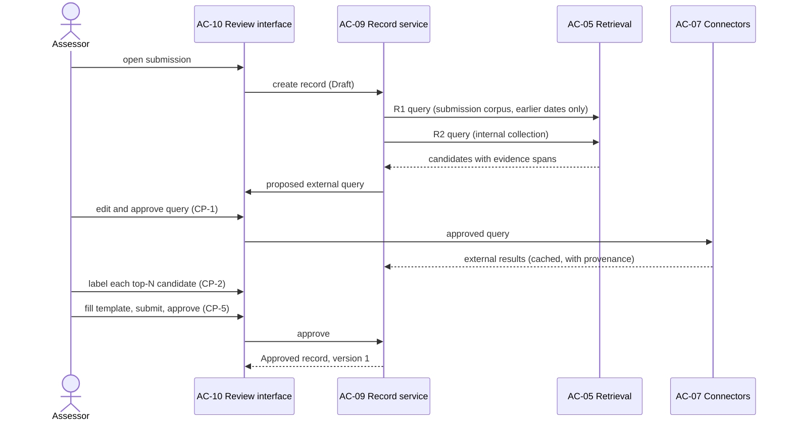

# S04_DATA_FLOWS_AND_INTERFACES

| Field | Value |
|---|---|
| Document ID | S04_DATA_FLOWS_AND_INTERFACES |
| Version | 1.0 |
| Status | SUBMITTED FOR GATE |
| Stage | S04 |
| Date | 2026-11-20 |
| Depends on | S04_ARCHITECTURE; S04_ASSUMPTIONS_AND_STANDARDS; ISS-005; ISS-008; ISS-009; ISS-033 |

- **Status of content:** PROPOSED interface and data-flow specifications at the level needed for Sections 8 and 12. Field lists marked OPEN depend on the sponsor's export format (ISS-008) and assessment content (ISS-005). Formats are named generically; concrete libraries and versions are chosen in S07.
- **IDs defined here:** IF (interface), DF (data flow). Component and checkpoint IDs refer to `S04_ARCHITECTURE`.

## 1. Interfaces

| ID | Interface | Between | Input | Output | Current project |
|---|---|---|---|---|---|
| IF-01 | Import file | Platform export or proxy data → AC-01 | Delimited text or JSON Lines file. Minimum fields: platform ID, title, body text, submission date. Optional: category, status, attachments' extracted text. Exact fields OPEN (ISS-008). Same format for internal-collection items, plus approval status and item date if available (ISS-003). | Import report: rows accepted, rejected with reason, duplicates by hash; import version ID | Yes |
| IF-02 | Retrieval API | AC-10, AC-06, AC-14 → AC-05 | Query text or submission ID; corpus (submissions or internal collection); number of candidates; filters (date before submission, status); configuration ID | Ranked candidates: item ID, final rank, score per stage, evidence spans (field and character offsets), configuration and index versions | Yes |
| IF-03 | Connector interface | AC-07 → external source plug-ins | Approved query text (CP-1); maximum results; optional date or classification filters where the source supports them | Results: source name, external ID, title, abstract or summary text, date, link, licence or terms note, retrieval time | Yes, one patent connector minimum (AS-08) |
| IF-04 | Assessment record API | AC-10 → AC-09 | Create record; attach candidates; record per-candidate label (CP-2); accept or reject summary (CP-3); confirm group (CP-4); submit; approve (CP-5); return. Every call carries the authenticated user. | Record state and version; rejection with reason when a rule (CP-1 to CP-6) is not met | Yes |
| IF-05 | Report export | AC-09 → AC-11 → assessor or file | Approved record ID | Human-readable report and a machine-readable copy with the same content, including candidate evidence, decisions, approver and component versions (AD-11) | Yes |
| IF-06 | Decision-log export | AC-09 → AC-14, later learning components | Date range or record set | Labelled pairs: submission ID, candidate ID, corpus, label, reason, assessor role (no name), time | Yes (FN-10) |
| IF-07 | Platform adapter | Sponsor platform ↔ AC-01 (and, in future, AC-09) | Read: new and changed submissions. Write (future, separate owner decision): approved outcomes | Same internal structures as IF-01 | Specified only; implemented in Section 11 row 2 |
| IF-08 | Identity | AC-12 ↔ identity source | Credentials or federated token | User ID and roles | Local project accounts (AS-05); sponsor identity provider in future |

## 2. Assessment record content (minimum, PROPOSED)

| Group | Fields | Source |
|---|---|---|
| Submission | Internal ID, platform ID, import version, language tag, text as imported | AC-01, AC-02 |
| R1 results | Similar submissions with rank, score, evidence spans, CP-2 labels; group membership after CP-4 | AC-05, AC-06 |
| R2 results | Internal-collection items with rank, evidence spans, CP-2 labels; flag "proxy collection" when AS-02 applies | AC-05 |
| R4 results | Approved query (CP-1), source, external items with link, date, licence note, CP-2 labels | AC-07 |
| Summary (optional) | Accepted or edited summary with citations; check result per sentence | AC-08, CP-3 |
| Assessment | Template fields and outcome code from the configured template (OPEN, ISS-005) | Assessor |
| Approval | State, approver identity, second approver if configured, time, version | CP-5, CP-6 |
| Provenance | Model, index, connector, template and software versions (AD-11) | AC-13 |

## 3. Data flows

### DF-01 Batch ingestion

1. An administrator places an export file (or proxy data set) in the import location.
2. AC-01 validates rows against the field map; rejected rows go to the import report.
3. AC-02 normalizes text, computes exact-copy hashes and near-duplicate fingerprints, tags language and segments long texts into passages.
4. AC-03 stores the new version; AC-04 updates the lexical and vector indexes for the affected corpus and records the index version.

Output: import report, updated corpus and index versions. No assessor action is needed; no record is created.

### DF-02 Assessment of a new submission

The R1 query is restricted to submissions dated before the one under assessment, so that the prototype behaves as it would on incoming submissions and matches the time-ordered evaluation (S02 §1; CLM-027). Evidence spans are displayed before any score or summary (AD-05).

### DF-03 Stored-collection grouping (R1, reading b)

AC-06 runs IF-02 for each stored submission against the rest of the corpus, keeps pairs above a threshold, and forms groups. Each group goes to an assessor queue. Only the CP-4 decision turns a proposed group into a confirmed link in the content store. Platform records are not changed.

### DF-04 External evidence retrieval (R4)

AC-07 builds a candidate query from the submission's title and key passages. The assessor sees the exact text that would be sent and may shorten or redact it (CP-1). Only the approved text leaves the controlled environment, which is the main data-protection control for R4 (ISS-033). Results are cached in AC-03 with source, retrieval time and licence note, so that the record can be reproduced if the external source changes.

### DF-05 Optional summary generation

When AD-08 is switched on, AC-08 receives the retrieved passages, generates a summary in which each sentence cites one or more passages, and runs a support check per sentence. Unsupported sentences are removed or marked. The assessor accepts, edits or rejects the result (CP-3). If ISS-009 rules out hosted models, AC-08 runs only on self-hosted models or stays off.

### DF-06 Approval and report export

CP-5 moves the record to Approved and writes the outcome. AC-11 produces the report (IF-05). Any later edit creates a new Draft version (CP-6). In the current project the report is a file; the approved outcome is not written to the platform (AD-03).

### DF-07 Decision logging

Each CP-2 and CP-4 decision is appended to the decision log with the corpus, label and reason. IF-06 exports it for AC-14 analysis (for example, how often assessors keep the top-ranked candidate unchanged). No component retrains on it in the current project (AD-10).

### DF-08 Offline evaluation

AC-14 orders the evaluation corpus by submission date, uses earlier items as the searchable corpus and later items as queries, runs each retrieval configuration through IF-02, and scores the results against assessor judgments. Metrics, judgment protocol and acceptance targets are S05 work (ISS-002, ISS-012, ISS-028).

## 4. Trust boundaries

| Boundary | What crosses it | Control |
|---|---|---|
| Platform → prototype | Export files | Read-only import (AD-03); import report; retention rules OPEN (ISS-036) |
| Prototype → external sources | Approved query text only | CP-1; connector logs in AC-13; source terms (ISS-006) |
| Prototype → hosted model service (only if ISS-009 allows) | Retrieved passages and prompt | AD-08 off by default; self-hosted default (AD-09) |
| User → prototype | Assessor and administrator actions | AC-12 roles; every IF-04 call authenticated and logged |
